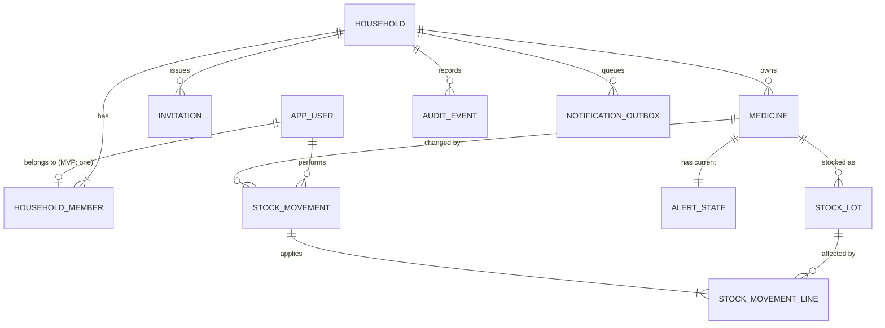

# Family Medicine Stock Tracker — Design (v0.1, draft for approval)

Status: **Proposed**. Nothing here is built yet. Items marked **[DECISION]** need your approval before Milestone 0.

---

## 0. Challenges to the brief (read this first)

Senior-engineer pushback. These change the design, so I raise them before anything else.

| # | Brief says | My position | Why |
|---|---|---|---|
| C1 | Single expiry date per medicine | **Track stock in batches ("lots"), each with its own expiry.** [DECISION] | When you buy a new strip, it has a different expiry from the old one. With one expiry per medicine you either overwrite it (and lose track of the old strips) or keep the old date (and wrongly flag fresh stock). "Never silently treat expired stock as usable" can't be done correctly without batches. The UI stays simple: when you restock, you can enter an expiry date; when you record a dose, the app takes it from the batch that expires first. |
| C2 | Low-stock alert based on a threshold | Keep it, but **count only usable (unexpired) stock** against the threshold, and **re-check every day**. | Stock can become "low" with nobody touching it: a batch expires overnight. A check that only runs when someone writes data would miss this. |
| C3 | Role-based permissions | **Only two roles: ADMIN and MEMBER.** | A family doesn't need a full permissions matrix. Admins manage members and archive medicines. Members do everything else. |
| C4 | Household accounts | **One household per user in the MVP.** The schema allows more later. | Supporting several households per user means a household switcher and scoping in every screen. Nobody in the family needs that yet. |
| C5 | Public sign-up (implied) | **Sign-up is closed.** You create the first household; everyone else joins by invitation. Controlled by `REGISTRATION_ENABLED`. | Open sign-up on a public URL invites spam accounts and abuse, and gives the family nothing. |
| C6 | Notify when stock is replenished | Keep it, but **one email per state change, a per-user opt-out, and a cooldown**. | Stock that hovers around the threshold (consume → low, correction → OK, consume → low) would send three emails in an hour. People who get spammed ignore all alerts, and the important ones go unread. |
| C7 | Accurate consumption tracking | **Design around "recount" as much as around dose logging.** | The biggest product risk isn't technical. People forget to log doses, the numbers drift, and the alerts become wrong. Make "I counted, there are 12 left" a 3-tap action, and make logging a dose 2 taps. |
| C8 | Separate frontend deployment | Fine, and good for learning. But it adds real complexity: CORS and cross-site cookies. See §6. **[DECISION]** | The alternative is serving the UI from Spring Boot (one deployable). I recommend separate deployment *plus a custom domain*, which removes most of the pain. |
| C9 | Audit for everything | **Stock changes go in an append-only ledger. Other changes (medicine edits, member changes) go in a light audit table.** | The ledger is your stock history *and* the audit trail for stock. No separate audit framework (no Envers etc.). |
| C10 | Brief doesn't mention it | **Cheap but valuable addition: an "I'll buy it" marker** on low-stock items. [DECISION] | It stops two family members from buying the same medicine. It's one nullable column and one endpoint. |

Explicitly **out of the MVP** (as you listed): schedules and reminders, missed doses, spending, pharmacy information, barcodes, voice, WhatsApp, automatic consumption. Also out: native mobile apps (the web app is installable on phones as a PWA instead), multiple households, offline mode, a "days of stock left" forecast. That forecast is the best first post-MVP feature.

---

## 1. Product requirements (concise PRD)

**Problem.** The family finds out a medicine is running low only when a few tablets are left. The local pharmacy may not have it in stock, so it becomes a last-minute scramble.

**Goal.** Make home medicine stock visible to everyone in the family, and warn them **early enough to restock without panic**.

**Users.**
- *Household admin* (you): sets up the household, invites members, owns the data.
- *Family member*: records doses and purchases, checks stock. May not be technical. May be elderly and using a phone.

**Success criteria (measured after one month of real use).**
1. No "we ran out" surprise for any medicine that was tracked.
2. Recorded stock is within ±10% of a physical count for medicines taken daily.
3. Every family member who takes a regular medicine has logged in at least weekly.
4. No more than 1 email per medicine per state change.

**Functional requirements (MVP).**
- FR1 Manage medicines: name, brand, strength, dosage form, unit, threshold, storage location, notes. Medicines are archived, never hard-deleted.
- FR2 Block accidental duplicates: same name + strength + dosage form in the same household.
- FR3 Record stock changes: purchase (optional expiry), consumption, recount/correction, disposal of expired stock, and undo (a reversal entry, not a deletion).
- FR4 Every stock change records who made it, when, what changed, and the resulting quantity.
- FR5 Usable stock = sum of unexpired batches. Expired stock is shown separately and flagged until someone disposes of it.
- FR6 Low-stock (≤ threshold) and out-of-stock alerts by email to members who opted in, sent only when the state changes. A "back in stock" email when it's resolved.
- FR7 Expiry warnings: batches expiring within N days (default 30, set per household) and batches that have expired.
- FR8 Household, invitations by email link, two roles, login/logout, password reset.
- FR9 Dashboard: total medicines, low/out list, expiring soon, expired stock awaiting disposal, recent activity, restock list (with "I'll buy it").
- FR10 Documented REST API (OpenAPI).

**Non-functional requirements.** Atomic stock changes, no lost updates under concurrent use, data survives restarts and redeploys, secure authentication, input validation, audit trail, tested backups and restores, all config from environment variables, no secrets in Git, structured logs, a health endpoint, consistent error format.

**Non-goals.** Medical advice, dosage guidance, drug-interaction checks, prescription management.

---

## 2. MVP feature breakdown

Priority: **P0** = the MVP is useless without it, **P1** = needed before the family relies on it, **P2** = nice to have in the MVP.

| Area | Feature | Pri | Notes |
|---|---|---|---|
| Auth | Email + password login, logout, current user (`/me`) | P0 | Session cookie stored in Postgres, so a restart doesn't log anyone out |
| Auth | Password reset by email | P1 | Family members *will* forget passwords |
| Household | Bootstrap: first sign-up creates the household and its admin | P0 | Then set `REGISTRATION_ENABLED=false` |
| Household | Invite by email (link valid 7 days), accept, revoke | P0 | The link proves the member owns that email |
| Household | Change role, remove member | P1 | |
| Medicines | Create / edit / archive / list / search | P0 | Edits use optimistic locking (ETag) |
| Medicines | Duplicate check | P0 | Unique index + a friendly 409 that links to the existing medicine |
| Stock | Purchase (+ optional expiry, entered as month/year) | P0 | Creates a batch |
| Stock | Consume (default: batch expiring first; optional batch choice) | P0 | Quantities can be decimals (½ tablet, 5 ml) |
| Stock | Recount / correction (absolute count + reason) | P0 | Checks the quantity you saw against the current one, to avoid lost updates |
| Stock | Dispose of an expired batch | P0 | The only way expired stock leaves the count |
| Stock | Undo a movement (adds a reversal entry) | P1 | Fixes a double-tap without deleting history |
| Stock | Idempotency key on every stock POST | P0 | Phone retries on bad networks must not consume twice |
| History | Ledger per medicine and for the household; audit events | P0 | |
| Alerts | Low / out / back-in-stock emails, sent on state change | P0 | Transactional outbox (see §4) |
| Alerts | Expiry-soon / expired emails (daily job) | P1 | |
| Alerts | Per-user notification opt-out | P1 | |
| Dashboard | Summary counts + lists | P0 | |
| Dashboard | "I'll buy it" claim on restock items | P2 | |
| Ops | Health check, structured logs, error tracking | P0 | |
| Ops | Nightly encrypted backup + restore drill | P1 | Must exist **before** the family starts relying on the app |
| Ops | CSV export | P2 | A safety net if a free tier ever disappears |

---

## 3. Database schema and entity relationships

PostgreSQL 16+, managed with **Flyway** migrations. All IDs are UUIDs. All timestamps are `timestamptz` stored in UTC. Each household has a `timezone`, used to decide what "today" means for expiry.



### Tables

**app_user** — `id`, `email citext UNIQUE`, `display_name`, `password_hash` (BCrypt), `notify_email boolean default true`, `disabled_at`, `created_at`, `last_login_at`.

**household** — `id`, `name`, `timezone` (e.g. `Asia/Kolkata`), `expiry_warning_days int default 30`, `created_at`.

**household_member** — `household_id`, `user_id`, `role` (`ADMIN`|`MEMBER`), `joined_at`. PK `(household_id, user_id)`. MVP: `UNIQUE(user_id)`.

**invitation** — `id`, `household_id`, `email citext`, `role`, `token_hash` (SHA-256 of a random 256-bit token; the token itself is never stored), `invited_by`, `expires_at`, `accepted_at`, `revoked_at`, `created_at`. Partial unique index: one open invitation per (household, email).

**medicine** — `id`, `household_id`, `name`, `brand_name`, `strength` (free text, e.g. "500 mg"), `dosage_form` (enum: TABLET, CAPSULE, SYRUP, DROPS, INHALER, CREAM, INJECTION, OTHER), `unit` (enum: TABLET, CAPSULE, ML, BOTTLE, STRIP, TUBE, PIECE, OTHER), `min_threshold numeric(10,2) >= 0`, `storage_location`, `notes`, `restock_claimed_by`, `restock_claimed_at`, `archived_at`, `version bigint` (optimistic lock), `created_by`, `created_at`, `updated_at`.
- Duplicate guard: `UNIQUE (household_id, lower(trim(name)), lower(coalesce(trim(strength),'')), dosage_form) WHERE archived_at IS NULL`.

**stock_lot** (a batch) — `id`, `household_id`, `medicine_id`, `expiry_date date NULL` (NULL = no expiry recorded, counted as usable), `quantity numeric(10,2) CHECK (quantity >= 0)`, `label` (optional, e.g. "new strip from Apollo"), `created_at`, `depleted_at`.
- An expiry printed as "08/2027" is stored as `2027-08-31`.
- **Usable stock** = `SUM(quantity) WHERE expiry_date IS NULL OR expiry_date >= today(household tz)`. It's calculated when needed, not stored, because a stored total would go stale when a batch expires overnight.

**stock_movement** (ledger header, append-only) — `id`, `household_id`, `medicine_id`, `type` (PURCHASE, CONSUMPTION, CORRECTION, DISPOSAL, REVERSAL), `note`, `performed_by`, `occurred_at` (when it happened, as entered by the user), `recorded_at` (when the server stored it), `usable_after numeric` (usable quantity right after this movement, for easy history display), `reverses_movement_id NULL UNIQUE`, `idempotency_key`, `UNIQUE(household_id, idempotency_key)`.

**stock_movement_line** — `id`, `movement_id`, `lot_id`, `delta numeric(10,2)` (signed), `lot_quantity_after`. One consumption can draw from two batches, so it produces two lines.

**alert_state** — `medicine_id PK`, `status` (OK, LOW, OUT), `changed_at`, `last_notified_status`, `last_notified_at`.

**notification_outbox** — `id`, `household_id`, `type` (LOW_STOCK, OUT_OF_STOCK, RESTOCKED, EXPIRING_SOON, EXPIRED, INVITATION, PASSWORD_RESET), `dedupe_key UNIQUE` (e.g. `EXPIRING_SOON:lot:<id>`), `payload jsonb`, `status` (PENDING, SENT, FAILED), `attempts`, `next_attempt_at`, `last_error`, `created_at`, `sent_at`.

**audit_event** — `id`, `household_id`, `actor_user_id`, `entity_type`, `entity_id`, `action`, `changes jsonb` (only the changed fields), `occurred_at`. Covers medicine create/edit/archive, member and invitation changes, logins (optional).

**password_reset_token** — `id`, `user_id`, `token_hash`, `expires_at`, `used_at`.

**spring_session** / **spring_session_attributes** — created by the Spring Session JDBC schema.

### Integrity rules enforced in the database (not only in Java)
- `CHECK (quantity >= 0)` on batches: the last line of defence against negative stock.
- The unique duplicate index on medicines.
- The unique idempotency key on movements.
- The unique dedupe key on the outbox.
- Foreign keys everywhere, `ON DELETE RESTRICT` (nothing important is ever hard-deleted).

---

## 4. Backend architecture

**Stack:** Java 21 LTS (or 25 LTS, decided in M0), the current Spring Boot release, Spring Web, Spring Security, Spring Data JPA (Hibernate), Spring Session JDBC, Flyway, Bean Validation, springdoc-openapi, Actuator. Tests: JUnit 5, Testcontainers (real Postgres; no H2, because H2 behaves differently from Postgres on locking and on SQL features like partial indexes), and MockMvc. Optional later: Spring Modulith to verify that modules don't reach into each other.

### Modular monolith: one deployable, package-per-module

```
com.familymeds
├── identity      users, login, sessions, password reset
├── household     households, members, roles, invitations
├── inventory     medicines, lots, stock movements, duplicate check   ← the core
├── alerts        alert state machine, expiry scan, outbox, email sender
├── dashboard     read-only queries (no writes)
├── audit         audit_event writer + query
├── jobs          /internal/jobs/* endpoints triggered externally
└── shared        error handling (problem+json), security context, clock, config
```

Rules: a module only calls another module through its public `*Service`/`*Api` class, never its repositories. `inventory` publishes `StockChanged` events. `alerts` listens for them. That's the only cross-module coupling in the write path.

### Concurrency design (the critical part)

Two family members tap "took 1 tablet" on the same medicine at the same moment. Both must be counted, and stock must never go negative.

1. **Stock movements lock the medicine row for update** (pessimistic lock).
   Each stock command runs in one `@Transactional` method:
   `SELECT … FROM medicine WHERE id=? AND household_id=? FOR UPDATE` → load its batches → apply the changes → insert the movement and its lines → recompute usable stock → update `alert_state` → insert an outbox row if the status changed → commit.
   The medicine row acts as the lock for the whole medicine (all of its batches). Concurrent writers to the same medicine take turns. Different medicines don't block each other. At family scale, the wait is milliseconds.
   *Why not optimistic locking here?* A consumption is a *relative* change ("minus 1"). It's always valid to apply after another change, so failing it with a 409 would only annoy the user. Taking turns gives the correct answer every time.
2. **Recount/correction is an absolute value**, so it carries `expectedQuantity` (what the user saw on screen). If the current quantity is different (someone logged a dose in between), the server returns **409**. The UI then shows "Stock changed to X while you were counting — save Y anyway?". No change is ever lost silently.
3. **Medicine detail edits** (name, threshold…) use **optimistic locking** (`@Version`, sent as `ETag` / `If-Match`). Two people editing the notes at once → the second gets a 409 instead of silently overwriting the first.
4. **Idempotency:** every stock POST requires an `Idempotency-Key` header (a UUID generated by the client per tap). If the same key arrives again, the server returns the original result instead of applying the change twice. This protects against double-taps and network retries.
5. **Database backstop:** `CHECK (quantity >= 0)`. If the application logic ever has a bug, the transaction fails rather than corrupting stock.
6. **Tests:** a Testcontainers test runs N threads × M consumptions on one medicine concurrently and asserts final stock = start − N·M with exactly N·M ledger entries. There's also a deliberate lost-update test for corrections.

### Alerts: a state machine plus a transactional outbox

- After every stock movement, inside the **same transaction**, compute the new status: `OUT` (usable = 0), `LOW` (usable ≤ threshold), else `OK`. If the status changed and the notification rules allow it (cooldown, e.g. no LOW→OK→LOW flapping emails within 6 h), insert a `notification_outbox` row.
- **Why an outbox:** the email must go out *only if* the stock change was committed, and the change must not be rolled back because the email server was slow. After commit, an `@TransactionalEventListener(AFTER_COMMIT)` tries to send asynchronously. Failures are retried with backoff by the daily job and on startup.
- **Daily job** (§6): recompute status for every medicine (catches batches that expired overnight), queue expiry-soon and expired notifications (deduped through `dedupe_key`), and retry failed outbox rows.
- Email goes through an `EmailSender` interface with an **HTTP API** provider (not SMTP — see §6) and a log-only implementation for local development and tests.

### Security
- Session cookie: `HttpOnly; Secure; SameSite=Lax`. Sessions are stored in Postgres, so they survive restarts and can be revoked.
- CSRF protection on (Spring's cookie-to-header pattern for SPAs).
- BCrypt password hashing. Login rate limiting (in-memory bucket, which is fine for a single instance). Generic "invalid credentials" message.
- **Household scoping:** every query filters by the `householdId` taken from the authenticated session, **never from the request**. The #1 bug class to prevent here is IDOR (requesting another household's medicine by its ID). Every endpoint gets a test that tries exactly that.
- Validation with Bean Validation on all DTOs. JPA entities are never exposed directly in the API.
- Secrets live only in environment variables (Render dashboard, GitHub Actions secrets). `.env` is in `.gitignore`. **gitleaks** runs in CI. Dependabot is on.

### Errors and observability
- RFC 9457 `application/problem+json` for every error, with a stable `code` field (`DUPLICATE_MEDICINE`, `STOCK_CONFLICT`, `INSUFFICIENT_STOCK`, …).
- Structured JSON logs with a request ID. Actuator `/actuator/health` (liveness + DB check). Sentry free tier for exceptions (optional, M9).

---

## 5. REST API design

Base path `/api/v1`. JSON. Session-cookie auth. OpenAPI at `/v3/api-docs`, Swagger UI at `/swagger-ui` (open in dev, behind login in prod). Lists use `?page=&size=`, plus `?cursor=` for history.

### Auth & identity
| Method | Path | Notes |
|---|---|---|
| POST | `/auth/register` | Only works if `REGISTRATION_ENABLED`. Creates the user, the household, and makes them ADMIN |
| POST | `/auth/login` | `{email, password}` → sets the session cookie |
| POST | `/auth/logout` | |
| GET | `/auth/me` | User + household + role. The frontend also uses it to warm up a sleeping server |
| POST | `/auth/password-reset` | `{email}` → always 202 (doesn't reveal whether an account exists) |
| POST | `/auth/password-reset/confirm` | `{token, newPassword}` |
| PATCH | `/me` | Display name, `notifyEmail`, password change |

### Household
| Method | Path | Role |
|---|---|---|
| GET / PATCH | `/household` | read: any / write: ADMIN (name, timezone, expiryWarningDays) |
| GET | `/household/members` | any |
| PATCH / DELETE | `/household/members/{userId}` | ADMIN (can't remove or demote the last admin) |
| GET / POST | `/household/invitations` | ADMIN |
| DELETE | `/household/invitations/{id}` | ADMIN (revoke) |
| GET | `/invitations/{token}` | public: shows household name and inviter |
| POST | `/invitations/{token}/accept` | public: `{displayName, password}` creates the account and joins the household |

### Medicines
| Method | Path | Notes |
|---|---|---|
| GET | `/medicines?q=&status=LOW,OUT&expiring=true&archived=false` | Each item includes `usableQuantity`, `expiredQuantity`, `status`, `nextExpiry` |
| POST | `/medicines` | Optional `openingStock {quantity, expiryDate}`. **409 `DUPLICATE_MEDICINE`** with `existingId` |
| GET | `/medicines/{id}` | Includes batches. Response has an `ETag` header |
| PATCH | `/medicines/{id}` | Requires `If-Match` → 412/409 if stale |
| POST | `/medicines/{id}/archive` · `/unarchive` | ADMIN |
| POST / DELETE | `/medicines/{id}/restock-claim` | "I'll buy it" / unclaim |

### Stock (all require the `Idempotency-Key` header and return the movement plus the updated medicine)
| Method | Path | Body |
|---|---|---|
| POST | `/medicines/{id}/purchases` | `{quantity, expiryDate?, label?, occurredAt?, note?}` |
| POST | `/medicines/{id}/consumptions` | `{quantity, lotId?, occurredAt?, note?}` → 422 `INSUFFICIENT_STOCK` (unless `lotId` is given, it never draws from expired batches) |
| POST | `/medicines/{id}/corrections` | `{lotId, countedQuantity, expectedQuantity, reason}` → 409 `STOCK_CONFLICT` |
| POST | `/medicines/{id}/disposals` | `{lotId, note?}` (disposes of an expired batch) |
| POST | `/stock-movements/{id}/reversal` | `{reason}` → 409 if already reversed |
| GET | `/medicines/{id}/movements` | Ledger for one medicine |
| GET | `/stock-movements?medicineId=&userId=&from=&to=` | Household-wide history |

### Dashboard, audit, jobs
| Method | Path | Notes |
|---|---|---|
| GET | `/dashboard` | `{totals, lowStock[], outOfStock[], expiringSoon[], expiredAwaitingDisposal[], restockList[], recentActivity[]}` |
| GET | `/audit-events?entityType=&entityId=` | ADMIN |
| POST | `/internal/jobs/daily` | Not session-authenticated. Requires the `X-Job-Token` header (a secret), compared in constant time. Returns a summary of what it did |

Status codes: 200/201, 204, 400 (validation, with a field error list), 401, 403, 404 (also returned for other households' resources — never 403, so IDs don't leak), 409, 412, 422, 429.

---

## 6. Deployment architecture (free tier first)

### Recommended setup [DECISION]

```
                 ┌──────────── your domain (≈ $10/yr, the one paid item) ───────────┐
 Family phones   │                                                                  │
 & laptops ──────┼─► app.<domain>  Cloudflare Pages (static React build, HTTPS)     │
   (PWA)         │        │ fetch, credentials: include (same-site → cookie works)  │
                 │        ▼                                                         │
                 └─► api.<domain>  Render free web service (Docker, Spring Boot)    │
                          │  JDBC/TLS, small Hikari pool                            │
                          ▼                                                         │
                     Neon Postgres (free, pooled endpoint)                          │
                          ▲                       │ HTTPS API                        │
   GitHub Actions ────────┤                       ▼                                  │
   • CI on PRs            │                  Email provider (Brevo / Resend)         │
   • CD on main → Render deploy hook         SPF/DKIM on your domain               │
   • cron: daily job → POST /internal/jobs/daily                                     │
   • cron: nightly pg_dump → age-encrypt → private storage                           │
```

| Concern | Choice | Why |
|---|---|---|
| Frontend | **React + Vite + TypeScript**, a few libraries (React Router, TanStack Query), plain CSS or Pico.css, PWA manifest | The REST API is the only interface (no duplicate server-rendered views). TanStack Query handles caching and retries. Static hosting is free and fast |
| Frontend hosting | **Cloudflare Pages** | Free, global CDN, preview deploy per PR, custom domain + HTTPS |
| Backend hosting | **Render free web service** (Docker) | Free tier, deploys from a Dockerfile, custom domain + automatic HTTPS, environment variables in the dashboard |
| Database | **Neon free** | Doesn't expire. (Render's free Postgres is deleted after ~30 days. Supabase free *pauses* after ~1 week without activity.) Scales to zero and wakes automatically |
| Email | **Brevo or Resend over an HTTP API**, sending from `alerts@<domain>` | See SMTP warning below. Your own domain with SPF/DKIM keeps alerts out of spam |
| Domain | Any registrar; DNS on Cloudflare | Gives `app.` and `api.` the *same site*. The session cookie then works in Safari/iOS (which blocks third-party cookies). Also gives you good email deliverability and URLs that stay the same if you change hosts |

**Fallback without a domain:** serve the React build *from Spring Boot itself* (one origin, no CORS, no cookie issues). Frontend and backend then deploy as one unit. This is perfectly good. You just don't learn separate frontend hosting. Do **not** put the frontend on `*.pages.dev` and the API on `*.onrender.com` with cookies. That's cross-site, and iOS Safari will break login.

### Free-tier limitations you will hit (verify current terms in M0 — they change)

| Limitation | Impact | Mitigation |
|---|---|---|
| **Render free sleeps after ~15 min without traffic**; startup takes time on a shared slow CPU | Spring Boot on 0.1 CPU can take **30–90 s** to wake. Your mother opens the app and sees a spinner for a minute | The frontend calls `/auth/me` right away and shows "Waking up the server…". Tune startup (fewer dependencies, `-XX:TieredStopAtLevel=1`, Class Data Sharing). Accept this for the beta. **Honest view: if it annoys the family, ~$7/month always-on is the right production fix.** |
| **Render: the filesystem is ephemeral** | Anything written to disk disappears on restart or deploy | Store nothing on disk. Everything goes in Postgres. Logs go to stdout |
| **Render: 512 MB RAM** | The JVM can be killed for using too much memory | `-XX:MaxRAMPercentage=75`, Serial GC, small thread pools, Hikari pool of 3–5 |
| **Render free may block outbound SMTP** (I believe it now does on free instances) | `spring-boot-starter-mail` over SMTP can silently fail | Use the email provider's **HTTPS API** from the start |
| **Neon scales to zero after ~5 min idle**; free compute hours are capped each month | First query after idle can take a few hundred ms to seconds | Connection-timeout settings tolerate wake-up. **Don't add keep-alive pings.** They burn Render hours *and* Neon compute hours and can use up the free allowance |
| **Neon free storage ~0.5 GB, short point-in-time restore window** | Plenty for a family (years of data is a few MB). The provider's restore history isn't a backup strategy | Run your own nightly backups (below) |
| **Background `@Scheduled` jobs don't run while the service sleeps** | Expiry checks would never run | **GitHub Actions cron calls `/internal/jobs/daily`** (this also wakes the server). Low-stock alerts don't need a scheduler, because they trigger when stock changes |
| **GitHub cron is UTC, can run late, and GitHub disables scheduled workflows after ~60 days without repo activity** | The daily job might silently stop | The job response is logged. A dashboard banner shows "last daily check: X". It's also covered in the runbook |
| **Email free quotas** (e.g. ~300/day, ~100/day) | Way more than a family needs | Dedupe + cooldown |

### CI/CD (GitHub Actions)
- **`ci.yml`** (every PR and push): backend `./mvnw verify` (unit + Testcontainers tests; GitHub's Ubuntu runners have Docker), frontend type-check + build, gitleaks secret scan, Docker image build.
- **`deploy.yml`** (push to `main`, after CI passes): call the Render deploy hook (auto-deploy is off on Render, so untested code never ships). Cloudflare Pages deploys the frontend on its own. Smoke test: poll `/actuator/health` until it reports UP.
- **Migrations:** Flyway runs on app start. Rule: migrations must be **backward-compatible with the previous app version** (add columns first, remove them in a later release), so a failed deploy can be rolled back.
- **`daily-job.yml`** (cron): `curl -fsS -X POST -H "X-Job-Token: $JOB_TOKEN" https://api.<domain>/api/v1/internal/jobs/daily`.
- **`backup.yml`** (nightly cron): `pg_dump` (client version matching the server) → encrypt with **age** using a public key (the private key lives *only* offline with you) → upload to private storage (Cloudflare R2 free tier, or GitHub artifacts with 30–90 day retention, since the dump is encrypted). **Monthly restore drill:** restore into a local Docker Postgres or a Neon branch and run a row-count check. A backup you've never restored isn't really a backup.

### Configuration (environment variables; never committed)
`SPRING_PROFILES_ACTIVE`, `DB_URL`, `DB_USER`, `DB_PASSWORD`, `APP_BASE_URL`, `API_ALLOWED_ORIGIN`, `EMAIL_API_KEY`, `EMAIL_FROM`, `JOB_TOKEN`, `REGISTRATION_ENABLED`, `SENTRY_DSN` (optional). Local development uses `docker compose` for Postgres plus an untracked `.env`, with `.env.example` committed.

---

## 7. Milestone roadmap

Each milestone ends **deployed, tested, and recorded in PROJECT_STATE.md**. Deployment comes first, not last.

| M | Goal | Deliverables | Done when |
|---|---|---|---|
| **M0** | Walking skeleton, deployed | Repo, Spring Boot + Actuator + Flyway (empty `V1`), docker-compose Postgres, multi-stage Dockerfile, CI workflow, Render + Neon set up, `/actuator/health` public over HTTPS | You can push a commit → CI passes → it's live. A test row survives a manual Render restart **and** a redeploy |
| **M1** | Auth + household bootstrap | Users, households, members, Spring Security sessions in JDBC, CSRF, register/login/logout/me, problem+json errors. React skeleton on Cloudflare Pages with a login page. Domain + `app.`/`api.` set up | You can log in from your phone on the deployed site. Sessions survive a backend restart. Security tests pass (401s, CSRF, rate limit) |
| **M2** | Medicines | CRUD, duplicate guard, archive, optimistic locking, audit_event, OpenAPI docs. Medicine list + form UI | Duplicate → friendly 409. Stale edit → 409. A cross-household IDOR test returns 404 |
| **M3** | Stock ledger (the core) | Batches, purchase/consume/correct/dispose/reverse, idempotency, row locking, usable vs expired quantities. Medicine detail screen with 2-tap consume and a recount flow | **Concurrency test passes** (N threads, no lost updates). Idempotency replay test passes. Negative stock is impossible. Ledger totals match batch totals |
| **M4** | Email + invitations | EmailSender (HTTP API + log fake), outbox, invitations, accept flow, password reset, roles enforced | You invite a family member's real email, they join from their own phone, and both of you see the same stock |
| **M5** | Low-stock alerts | alert_state machine, cooldown, per-user opt-out, after-commit sending + retry | Crossing the threshold sends exactly one email, replenishing sends one "back in stock", flapping is suppressed. Tests cover each transition |
| **M6** | Expiry + daily job | Expiry-soon/expired logic in the household timezone, daily job endpoint, GitHub Actions cron, "last run" indicator | A batch with yesterday's expiry shows as expired, isn't counted as usable, and triggers one email |
| **M7** | Dashboard + PWA polish | `/dashboard`, restock list + "I'll buy it", installable PWA, large touch targets, "waking up" state | Usability test: a non-technical family member logs a dose and finds a low medicine without help |
| **M8** | Production readiness | Encrypted nightly backup + **restore drill**, Sentry, structured logs, Dependabot, a security review pass, a runbook (`docs/RUNBOOK.md`: deploy, roll back, restore, rotate secrets) | You've restored production data into a clean database from a backup |
| **M9** | Family beta | Enter the real medicines, do the first physical count, set `REGISTRATION_ENABLED=false`, two weeks of use, then a review | The success criteria in §1 are tracked |

Post-MVP candidates, in order of value: **days-of-stock forecast** (estimated daily usage → "runs out around 3 Dec", and alerts based on pharmacy lead time instead of a fixed threshold), schedules with *confirmed* doses, spending, barcodes, WhatsApp.

---

## 8. Risks

| Risk | Likelihood | Impact | Mitigation |
|---|---|---|---|
| Family stops logging → stock drifts → alerts become wrong | **High** | **High** | 2-tap consume, easy recount, a weekly "please recount" reminder later, PWA on the home screen |
| Cold starts make the app feel broken | High | Medium | "Waking up" screen, startup tuning, budget for ~$7/month if needed |
| Login breaks on iOS because of cross-site cookies | High *without a domain* | High | Custom domain (same-site) or serving the UI from the backend |
| Alerts land in spam / SMTP blocked | Medium | High | HTTP-API email provider, own domain with SPF/DKIM, test with each family member's inbox in M4 |
| A free tier changes terms or deletes data | Medium | High | Encrypted nightly backups + restore drill + CSV export. Keep the app portable (plain Docker + Postgres) |
| Lost or duplicated stock updates under concurrency or retries | Medium | High | Row lock, expected-quantity check, idempotency keys, DB CHECK constraint, concurrency tests |
| Data leaks between households (IDOR) | Low (one household) | High | Session-derived household scoping + a test per endpoint |
| Health data exposure | Low | High | HTTPS everywhere, no medicine names in URLs or logs, encrypted backups, minimal personal data |
| Scope creep (schedules, WhatsApp…) | High | Medium | This document. Post-MVP list. Approval gate before each milestone |
| Burnout as the only maintainer | Medium | Medium | Small milestones, a runbook, boring technology |

---

## 9. Decisions needing your approval

1. **D1 — Batch (lot) model** for stock and expiry (C1). *Recommended.*
2. **D2 — Frontend:** React + Vite SPA on Cloudflare Pages **with a custom domain** (~$10/yr). Alternative: serve the SPA from Spring Boot, with no domain needed.
3. **D3 — Hosting:** Render (backend) + Neon (database) + Brevo/Resend over HTTP API (email).
4. **D4 — Auth:** email + password, server-side sessions stored in Postgres (not JWT). Closed sign-up, invitations only.
5. **D5 — Include "I'll buy it"** restock claim (P2, small).
6. **D6 — Java 21 vs 25:** I'll check what the hosting and tooling support well in M0 and recommend one.
